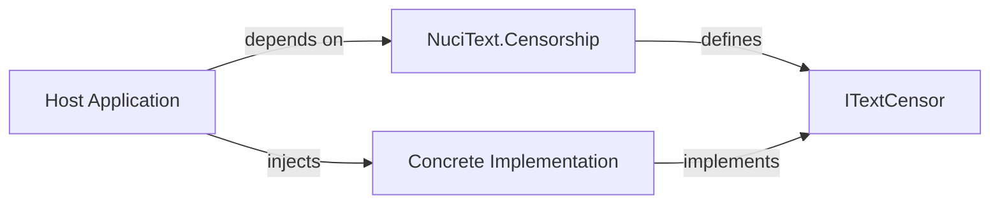
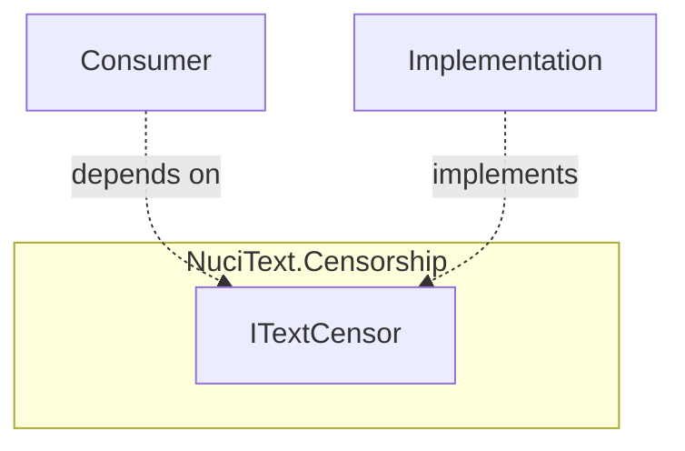
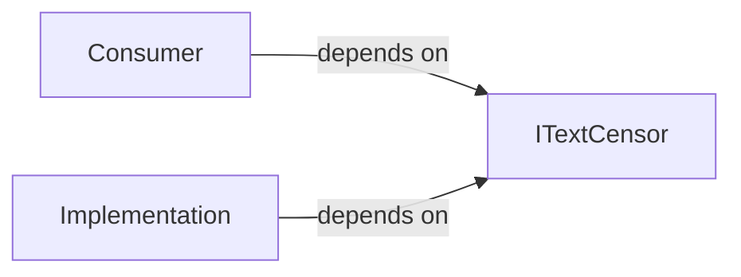

# NuciText.Censorship Architecture

This document describes the current architecture of NuciText.Censorship, a .NET library that provides a common abstraction for text censorship. It covers the library's public contract, internal structure, dependency direction, and extension points.

## 📑 Table of Contents

- [Purpose](#-purpose)
- [System Context](#-system-context)
- [Architectural Style](#-architectural-style)
- [Runtime Flow](#-runtime-flow)
- [Components](#-components)
- [Interfaces and Integrations](#-interfaces-and-integrations)
- [Cross-Cutting Concerns](#-cross-cutting-concerns)
- [Dependency Direction and Rules](#-dependency-direction-and-rules)
- [External Dependencies](#-external-dependencies)
- [Deployment and Operations](#-deployment-and-operations)
- [Compatibility Contracts](#-compatibility-contracts)
- [Testing and Verification](#-testing-and-verification)
- [Extension Points](#-extension-points)

## 🎯 Purpose

NuciText.Censorship provides a stable, versioned `ITextCensor` interface that host applications can depend on for text censorship functionality. The library defines the contract; concrete implementations (e.g., language-specific censors) are provided by separate packages. The intended audience is library consumers and implementers of censorship providers.

## 🌐 System Context

NuciText.Censorship is a library consumed by host applications. It has no runtime process of its own.



The principal external boundaries are:
- **Host Application:** Consumes the `ITextCensor` abstraction via dependency injection; supplies text to censor and receives censored text.
- **Concrete Implementation:** Provides the censorship logic (bad-word lists, URL detection, replacement strategy); implemented in separate packages (e.g., `NuciText.Censorship.English`).

## 🏗️ Architectural Style

**Interface-based abstraction layer** — The library defines a single public interface (`ITextCensor`) with no implementation. This is a classic "abstraction package" pattern: the package establishes a stable contract that decouples consumers from concrete censorship implementations.



The principal architecture boundaries are:
- **Public Contract (`ITextCensor`):** Stable interface; consumers and implementers depend on this only.
- **Internal:** The package contains no internal implementation, helpers, or state.

## 🔄 Runtime Flow

NuciText.Censorship has no independent runtime. The flow is determined by the host application:

1. Host application starts and configures dependency injection.
2. Host registers a concrete `ITextCensor` implementation.
3. Consumer requests `ITextCensor` via DI and calls `Censor(text)`.
4. Implementation processes text and returns censored result.

## 🧩 Components

| Component | Responsibility | Principal Dependencies | Lifetime or Ownership |
|-----------|----------------|------------------------|-----------------------|
| `ITextCensor` | Defines the censorship contract: `string Censor(string text)` | None (pure interface) | Singleton per DI container; owned by host application |

## 🔌 Interfaces and Integrations

| Interface or Integration | Direction | Contract | Owner | Failure Semantics |
|--------------------------|-----------|----------|-------|-------------------|
| `ITextCensor` | Inbound (called by consumer) | `string Censor(string text)` | NuciText.Censorship | Returns censored text; exceptions propagate to caller |

## 🧵 Cross-Cutting Concerns

### Security and Privacy

The library processes only the text supplied by the caller. It does not log, persist, or transmit data. Input validation is the responsibility of the concrete implementation. The abstraction itself imposes no trust boundaries.

### Error Handling

The `Censor` method signature does not declare exceptions. Concrete implementations may throw (e.g., `ArgumentNullException` for null input). Consumers should handle exceptions at the call site.

### Configuration

NuciText.Censorship has no configuration. Concrete implementations may have their own configuration (e.g., word lists, replacement characters) managed by the host application.

## 🧭 Dependency Direction and Rules



The principal dependency rules are:
- Consumers depend only on `ITextCensor` (this package).
- Implementations depend only on `ITextCensor` (this package).
- This package has zero dependencies on implementations or consumers.
- No circular dependencies are possible by design.

## 📦 External Dependencies

| Dependency | Responsibility | Integration Boundary | Architectural Consequence |
|------------|----------------|----------------------|---------------------------|
| .NET Runtime (net10.0) | Base class library, `System.String` | Implicit | Requires .NET 10.0+ runtime |

## 🚀 Deployment and Operations

| Concern | Current Design | Architectural Consequence |
|---------|----------------|---------------------------|
| Distribution | NuGet package (`NuciText.Censorship`) | Consumers add via `dotnet add package` |
| Versioning | Semantic versioning; `GenerateDocumentationFile=true` | Public API surface documented in XML |
| Target Framework | net10.0 | Runs on .NET 10.0+ |
| Strong Naming | Not signed | No strong-name binding redirects |

## 🛡️ Compatibility Contracts

| Contract | Owner | Invariant | Verification | Change Policy |
|----------|-------|-----------|--------------|---------------|
| `ITextCensor.Censor(string)` | NuciText.Censorship | Method signature, return type, and namespace remain stable | Compile-time; XML doc generation | Breaking changes require major version bump |

## ✅ Testing and Verification

The library itself contains no tests (it is an interface-only package). Verification is performed by:
- Consumer integration tests that exercise concrete implementations.
- Build verification: `dotnet build NuciText.Censorship` succeeds.
- Package validation: `dotnet pack` produces a valid NuGet package.

Execute the principal automated verification with:

```bash
dotnet build NuciText.Censorship
```

## ⚙️ Extension Points

The library is designed for extension via implementation of `ITextCensor`:

1. Create a new project (e.g., `NuciText.Censorship.English`).
2. Reference `NuciText.Censorship`.
3. Implement `ITextCensor` with language-specific logic.
4. Publish as a separate NuGet package.
5. Consumers register the implementation via DI.

No registration or discovery mechanism is provided by this package; composition is entirely under host application control.