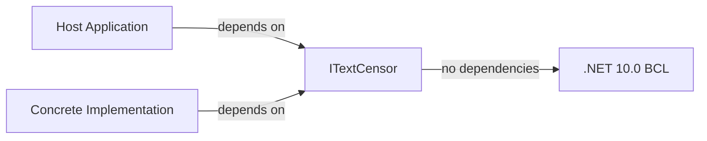

# Architecture

This document complements the root [ARCHITECTURE.md](../ARCHITECTURE.md). It elaborates on the architectural style, component relationships, and design rationale with additional detail and cross-references to the generated documentation.

## Architectural style

**Interface-based abstraction layer.** The package follows the "abstraction package" pattern: it defines a stable contract (`ITextCensor`) that decouples consumers from concrete implementations. There is no implementation, no internal logic, and no runtime behaviour within this package.

## Component model

The package contains exactly one component:

| Component | Type | File | Responsibility |
|-----------|------|------|----------------|
| `ITextCensor` | Interface | `NuciText.Censorship/ITextCensor.cs` | Declares the `string Censor(string text)` contract. |

No other classes, structs, enums, or helper types exist in the package.

## Dependency direction

- Consumers depend only on `ITextCensor`.
- Implementations depend only on `ITextCensor`.
- The package has zero dependencies on implementations or consumers.
- No circular dependencies are possible by design.

## Namespace note

The `ITextCensor` interface is declared in the `NuciText.Censorship.English` namespace. This is the canonical namespace for the contract. Concrete implementations in separate packages should reference this namespace when implementing the interface.

## Design rationale

| Decision | Rationale |
|----------|-----------|
| Interface-only package | Allows multiple implementations (language-specific, domain-specific) to coexist without consumers coupling to a particular one. |
| No DI registration helpers | Keeps the package dependency-free and avoids coupling to a specific DI container or framework. |
| No configuration | Configuration is implementation-specific; the abstraction should not impose a schema. |
| No logging or telemetry | Preserves privacy and minimises the trust boundary; the package processes no data of its own. |
| `net10.0` target | Aligns with the latest .NET runtime; consumers must target .NET 10.0 or later. |
| `ImplicitUsings` disabled | Explicit `using` directives are required, keeping the code self-documenting. |
| `Nullable` enabled | Enforces null-safety at the interface boundary. |

## Extension model

Implementations are created in separate packages:

1. Create a new project (e.g., `NuciText.Censorship.English`).
2. Reference `NuciText.Censorship`.
3. Implement `ITextCensor` with language-specific logic.
4. Publish as a separate NuGet package.
5. Consumers register the implementation via DI.

No registration or discovery mechanism is provided by this package; composition is entirely under host application control. See [Extension points](./components/host-and-composition.md) for details.
