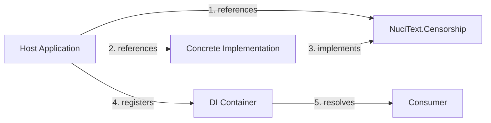

# Host and composition

## Overview

NuciText.Censorship does not provide any dependency-injection registration, service discovery, or composition mechanism. The package defines only the `ITextCensor` interface; the host application is responsible for selecting, instantiating, and registering a concrete implementation.

## Composition flow



1. The host application references both `NuciText.Censorship` (for the interface) and a concrete implementation package.
2. The concrete implementation implements `ITextCensor`.
3. The host registers the implementation in its DI container (e.g., `services.AddSingleton<ITextCensor, EnglishTextCensor>()`).
4. Consumers request `ITextCensor` via constructor injection.

## Host responsibilities

| Responsibility | Detail |
|----------------|--------|
| Implementation selection | Choose which concrete `ITextCensor` implementation to use. |
| Registration | Register the implementation in the DI container. |
| Lifetime management | Determine the service lifetime (singleton, scoped, transient). |
| Configuration | Configure the implementation (word lists, replacement characters, etc.). |
| Error handling | Handle exceptions thrown by `Censor` at the call site. |

## Package responsibilities

The package provides:

- The `ITextCensor` interface definition.
- NuGet package metadata.
- XML documentation generation.

The package does **not** provide:

- Any `AddNuciTextCensorship()` or similar extension method.
- Any options class or configuration schema.
- Any factory or builder pattern.
- Any service provider or locator.

## Example registration

```csharp
// In the host application's DI configuration:
using NuciText.Censorship.English;

// Assuming a concrete implementation exists in a separate package:
services.AddSingleton<ITextCensor, EnglishTextCensor>();
```

## Implications

- **Decoupling:** The host can swap implementations without changing consumer code.
- **No lock-in:** The package does not depend on any DI framework.
- **Explicit composition:** The host must explicitly wire up the implementation, making dependencies visible.
