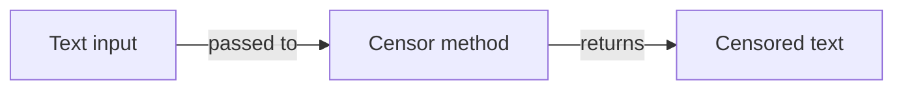

# Integration models

## Overview

NuciText.Censorship integrates with the broader system through a single contract: the `ITextCensor` interface. There are no external service calls, no HTTP clients, no message queues, no event buses, and no persistence layers within this package.

## Integration boundaries

| Boundary | Direction | Protocol | Owner |
|----------|-----------|----------|-------|
| Host application | Consumer | .NET interface call | Host application |
| Concrete implementation | Provider | .NET interface implementation | Separate package |
| .NET 10.0 runtime | Platform | BCL | Microsoft |
| NuGet | Distribution | Package reference | NuGet.org |

## No external integrations

The package does not integrate with:

- External web services or APIs.
- Databases or persistence stores.
- Message queues or event streams.
- Logging frameworks or telemetry systems.
- Configuration providers.
- Authentication or authorisation services.

## Data flow

All data flow occurs between the caller and the concrete implementation. The abstraction package itself is a passive contract — it does not process, transform, or store any data.

## Serialization

The package does not define any serializable types. The `ITextCensor` interface is not serializable. Serialization of censored text is the responsibility of the host application.

## Versioning and compatibility

The package follows semantic versioning. The `ITextCensor` interface signature is a compatibility contract: any change to the method signature requires a major version bump. See [Compatibility contracts](../ARCHITECTURE.md#-compatibility-contracts) in the root architecture document.
