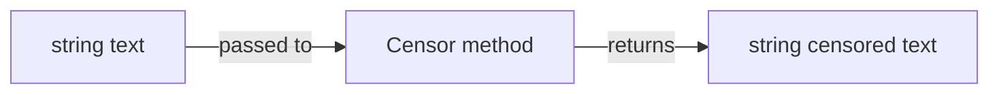

# Data model

## Overview

NuciText.Censorship has no domain model, no entities, no value objects, and no persistence. The package defines a single interface with a single method that accepts and returns strings.

## Types

| Type | Kind | Namespace | File | Description |
|------|------|-----------|------|-------------|
| `ITextCensor` | Interface | `NuciText.Censorship.English` | `ITextCensor.cs` | Defines the `Censor(string) → string` contract. |

No other types are defined in the package.

## Data flow

- **Input:** A `string` containing the text to censor.
- **Output:** A `string` containing the censored text.
- **Transformation:** Performed entirely by the concrete implementation.

## Persistence

The package does not persist any data. It does not read from or write to databases, files, or any other storage. All data is processed in memory and returned to the caller.

## Relationships

There are no entity relationships. The package is a pure abstraction with no data model of its own.

## Serialization

The `ITextCensor` interface is not serializable. The package does not define any serializable types. Serialization of input or output text is the responsibility of the host application.
