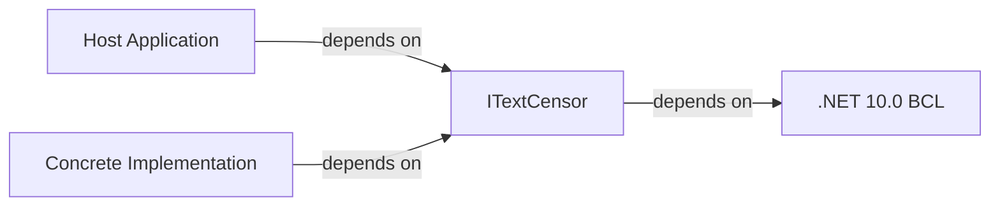

# Dependencies

## External dependencies

| Dependency | Version | Purpose | Integration boundary |
|------------|---------|---------|---------------------|
| .NET Runtime | net10.0 | Base class library, `System.String` | Implicit |

The package has zero NuGet package dependencies. It depends only on the .NET 10.0 runtime.

## Internal dependencies

The package has no internal dependencies. It contains a single file (`ITextCensor.cs`) and a single project file (`NuciText.Censorship.csproj`).

## Dependency direction

- Consumers depend only on `ITextCensor`.
- Implementations depend only on `ITextCensor`.
- The package has zero dependencies on implementations or consumers.
- No circular dependencies are possible by design.

## Transitive dependencies

None. The package has no transitive dependencies.

## Development dependencies

None. The package does not use any development-time NuGet packages (analyzers, testing frameworks, etc.).
