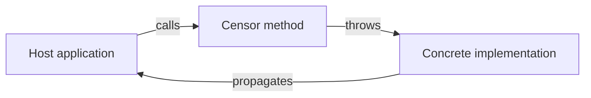

# Error handling

## Overview

NuciText.Censorship is an interface-only package. It does not implement any error handling logic. Error handling is the responsibility of the concrete implementation and the host application.

## Error taxonomy

| Error type | Source | Handling |
|------------|--------|----------|
| `ArgumentNullException` | Concrete implementation | Thrown when `text` is null. |
| `ArgumentException` | Concrete implementation | Thrown when `text` is invalid (e.g., empty). |
| `InvalidOperationException` | Concrete implementation | Thrown when the censor is in an invalid state. |
| Other exceptions | Concrete implementation | Implementation-specific. |

## Error propagation

The `Censor` method does not catch or wrap exceptions. Any exception thrown by the concrete implementation propagates directly to the caller.



## Consumer responsibilities

The host application should handle exceptions at the call site:

```csharp
try
{
    string censored = textCensor.Censor(message);
}
catch (ArgumentNullException ex)
{
    // Handle null input
}
catch (Exception ex)
{
    // Handle other errors
}
```

## No retry logic

The package does not provide retry policies. If the host application needs retry logic, it must implement it around the `Censor` call.

## No circuit breaker

The package does not provide circuit breaker functionality. If the host application needs circuit breaking, it must implement it around the `Censor` call.

## Logging of errors

The package does not log errors. If the host application needs error logging, it must implement it around the `Censor` call.
