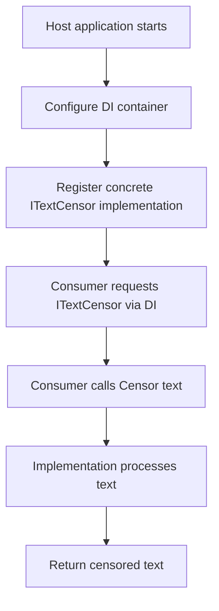

# Startup and rendering

## Overview

NuciText.Censorship is a library, not an application. It has no startup sequence, no rendering pipeline, and no application lifecycle of its own. The flow is entirely determined by the host application.

## Library lifecycle

The package has no lifecycle events. It is loaded when the host application references it and the `ITextCensor` interface is resolved. There is no initialisation, no configuration loading, and no teardown.

## Host application flow

The typical flow when using NuciText.Censorship is:

## No rendering

The package does not:

- Render UI components.
- Generate HTML, JSON, or any output format.
- Participate in any view or template engine.
- Handle HTTP request/response cycles.

## No startup configuration

The package does not:

- Provide `IStartup` or `IHostedService` implementations.
- Register middleware.
- Configure services via extension methods.
- Read configuration files.

All configuration and registration is performed by the host application and the concrete implementation package.
