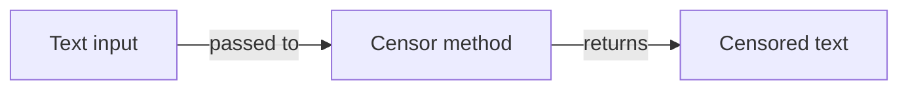

# State and persistence

## Overview

NuciText.Censorship is stateless. The package contains no state, no caches, no stores, and no persistence mechanisms. It is a pure interface abstraction.

## State

| State type | Present | Owner |
|------------|---------|-------|
| In-memory state | No | N/A |
| Caches | No | N/A |
| Session state | No | N/A |
| Application state | No | N/A |
| Configuration state | No | N/A |

## Persistence

The package does not persist any data. It does not:

- Write to databases.
- Write to files.
- Write to caches.
- Write to logs.
- Write to any external storage.

## Data lifecycle

All data is processed in memory by the concrete implementation and returned to the caller. The abstraction package itself does not participate in any data lifecycle.

## Migrations

Not applicable. The package has no persistent state to migrate.

## Concurrency and state

Since the package has no state, there are no concurrency concerns at the package level. Thread safety is determined by the concrete implementation. See [Concurrency and scheduling](./concurrency-and-scheduling.md).

## Related documentation

- [Data model](./data-model.md)
- [Concurrency and scheduling](./concurrency-and-scheduling.md)
- [Privacy policy](../PRIVACY.md)
